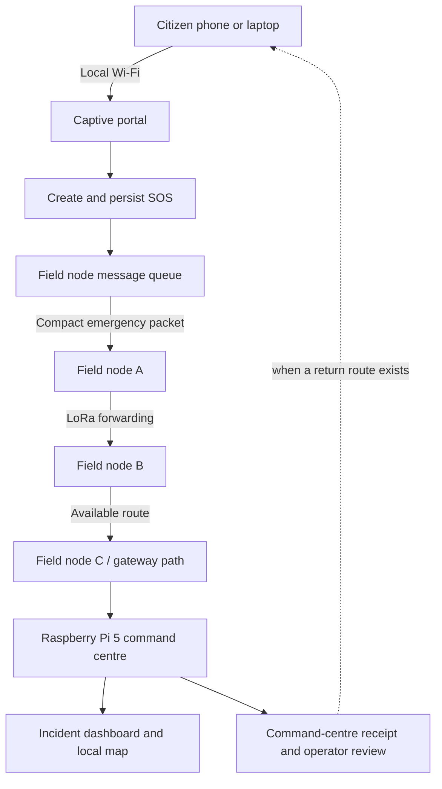

# NexAlert — Disaster-Resilient Emergency Communication System

**When conventional networks fail, emergency communication should remain locally useful.**

NexAlert is a proposed offline-first emergency communications system for disaster-affected communities. It explores how portable field nodes, LoRa radio links, local Wi-Fi access, persistent message queues and a local command centre can help citizens submit emergency requests when cellular or internet connectivity is unavailable or unreliable.

> **Project status:** Concept and prototype development. The architecture, radio hardware configuration and end-to-end delivery path are still being validated. Features and performance targets described as planned are not claims of completed implementation.

## Phase 1 software milestone

### Phase 2 failover software status

The hardware-independent failover controller and host-side fallback SOS store are implemented and covered by deterministic tests. They model heartbeat freshness, conservative partition handling, fallback activation, durable local acceptance, backup restart recovery, and same-ID reconciliation through the existing SOS path. Dashboard node status is sourced from persisted failover state. Development simulation controls are disabled by default; enable them only with `NEXALERT_ENV=development NEXALERT_ENABLE_FAILOVER_SIM=1` (tests enable them through Flask testing mode).

This is not physical ESP32-S3/Pi failover. The SQLite fallback store is a host simulation, the radio remains unconfigured, and no physical timing measurement satisfies the DPR's under-90-second criterion. See [docs/failover-design.md](docs/failover-design.md) for transitions, API, safety limits, recovery policy, and the required bench verification sequence.

### Windows PowerShell setup

Use Python 3.9–3.11 as declared in `requirements.txt`, from the project directory:

```powershell
py -3.11 -m venv .venv
.\.venv\Scripts\Activate.ps1
python -m pip install -r requirements.txt
python -m unittest discover -s tests -v
python scripts/e2e_http_smoke.py
python backend\app.py
```

PowerShell database configuration uses distinct files:

```powershell
$env:NEXALERT_DB = "database\nexalert.db"
$env:NEXALERT_CC_DB = "database\command-centre.db"
```

### WSL setup

Use the pinned versions in `requirements.txt` without changing them. Python 3.9–3.11 is the declared compatibility range; this workspace currently has Python 3.12.3, which is outside that declared range.

```bash
cd /home/venom/NexAlert-main-phase1
sudo apt update && sudo apt install python3.12-venv
python3 -m venv .venv  # create/reuse the project-local environment
source .venv/bin/activate
python -m ensurepip --upgrade  # repairs this workspace's existing --without-pip venv
python -m pip install -r requirements.txt
python -m unittest discover -s tests -v
python scripts/e2e_http_smoke.py
python backend/app.py
```

Open `http://localhost:5000/` for the citizen interface and `http://localhost:5000/dashboard` for the command-centre view. Database defaults are `database/nexalert.db` (sender/app) and `database/command-centre.db` (simulated receiver). Set `NEXALERT_DB` and `NEXALERT_CC_DB` before launch to select separate paths; keep those paths distinct. The dashboard has no operator authentication and must stay on a trusted local network.

The project verification environment is `.venv-phase1-verify` (Python 3.12.3); the declared deployment compatibility range remains Python 3.9–3.11. Tests and the localhost smoke runner are executed from normal WSL because the restricted Codex sandbox cannot create sockets or temporary files.

For WSL network diagnosis, check Linux `getent hosts pypi.org`, `curl -I --connect-timeout 10 https://pypi.org/simple/flask/`, `cat /etc/resolv.conf`, and `cat /etc/wsl.conf`; from Windows PowerShell check `wsl --version`, `wsl --status`, `Resolve-DnsName pypi.org`, `Get-DnsClientServerAddress`, `curl.exe -I --connect-timeout 10 https://pypi.org/simple/flask/`, and `$HOME\.wslconfig`. Do not hard-code a resolver or replace WSL-managed `/etc/resolv.conf`. Microsoft documents DNS tunneling for Windows 11 22H2+ and recommends it for DNS problems involving VPNs or firewall policy; `.wslconfig` is global and changes require restarting WSL. Only set `dnsTunneling=true` after checking Windows/WSL support and confirming the setting is disabled; use `autoProxy=true` only if Windows actually uses an HTTP proxy. In this execution environment DNS lookups fail, `curl` cannot resolve either PyPI or Ubuntu archive hosts, and the network namespace exposes no default route. WSL process interop was denied, so the Windows host resolver and full WSL package version could not be queried here; no machine-wide or resolver configuration was changed.

### Current software architecture and demo

- The existing Flask API and citizen/dashboard pages remain. The citizen shell has a service-worker cache and keeps pending browser submissions with their incident key in local storage; server-side SQLite remains the durable sender queue once a request reaches Flask.
- `alerts` retains existing incidents and adds location, idempotency, delivery, receipt timestamp, lifecycle and assignment fields through additive startup migration. `outbound_queue`, `delivery_attempts` and `incident_events` persist transport progress and history.
- `SimulatedTransport` writes to a separate receiver SQLite database. Receiver incident and receipt rows commit before sender state is marked received. Failed sends, disconnects and lost acknowledgements are retryable; duplicate destination writes are suppressed by primary keys.
- Delivery status is independent of operational lifecycle. Operators can assign, dispatch, mark arrival, and resolve in validated order. Assignment does not imply dispatch.
- Development controls are available at `POST /api/transport/simulated` in tests/debug or when both `NEXALERT_ENV=development` and `NEXALERT_ENABLE_SIM_CONTROLS=1` are set. They are disabled by default and the control flag alone does not enable them.

To reproduce the simulated workflow after dependencies are installed: launch the app with `NEXALERT_ENV=development NEXALERT_ENABLE_SIM_CONTROLS=1`; disconnect with `curl -X POST localhost:5000/api/transport/simulated -H 'Content-Type: application/json' -d '{"connected":false}'`; submit a citizen SOS; stop and restart Flask; confirm transport remains disconnected and the report remains queued; reconnect with `{"connected":true}`; confirm the incident appears on `/dashboard` as received; then assign a responder and separately use Dispatch, Mark arrived, and Resolve. To demonstrate a lost receipt, first set `{"lose_next_ack":true}`, submit SOS, observe it remains queued despite receiver persistence, then retry/reconnect and observe the same incident receives its stored receipt. Direct simulated delivery has no relay hop, so it never claims `relayed`; that state is reserved for a future transport that returns a real relay receipt. `{"fail_next_transmission":true}` demonstrates a failed send retained for retry.

For an automated localhost HTTP run of startup, restart persistence, lost-ack retry, receipt deduplication, operator lifecycle, and database isolation, run `python scripts/e2e_http_smoke.py`. It selects a temporary port and temporary sender/receiver databases, and verifies the production database hash is unchanged.

### Verification and capability boundary

**Implemented in source:** optional SOS coordinates/landmark, stable incident and idempotency key, browser retry storage, SQLite sender queue, separate simulated receiver/receipt, follow-up details, restored four-tab citizen UI, local dashboard broadcasts, persisted status summaries, session-bound WebRTC signalling, status history and operator transitions. The local WebSocket client implements only the Engine.IO v4 / Socket.IO event subset used by this app; API reads remain HTTP-based. **Verification (2026-10-28):** the suite contains 38 tests; the final rerun and HTTP smoke run are recorded with the current UI restoration changes. Browser/device layout, actual microphone permission/media, offline tile coverage, and service-worker behavior with the browser fully offline still require browser validation. The reference screenshot directory was absent from this checkout, so pixel-level comparison could not be done. The project database and dated backups must remain protected; tests use temporary SQLite files.

**Simulated only:** disconnect/reconnect, direct simulated delivery, failed send, lost acknowledgement, receiver persistence and receipt. The direct simulator has no relay hop. No physical LoRa, real mesh/failover, actual captive-portal behavior on hardware, government alert integration, 48-hour battery life or 100-client capacity is implemented or claimed. Phase 2 begins at the `SosTransport` boundary: replace/add a real transport adapter with radio framing, addressing/routing, retry/ACK semantics, hardware gateway integration and field validation while retaining the incident IDs, durable queue, receiver commit-before-receipt contract and dashboard/API lifecycle.

## The problem

Floods, cyclones, power failures and damaged infrastructure can interrupt cellular and internet services precisely when residents need to contact family members or request help. Even when a local radio link is available, an emergency system must still answer important questions:

- Was the SOS saved locally, forwarded to another node, or actually received by the command centre?
- What happens if a communication path breaks before a message is delivered?
- Can pending messages be forwarded after connectivity returns without creating duplicate incidents?
- Can a rescue operator see useful incident details without treating uncertain or stale information as fact?

NexAlert focuses on the end-to-end emergency workflow—not simply transmitting a packet.

## Project objective

Develop and evaluate a low-cost, portable communication network that can accept and preserve emergency reports during connectivity loss, forward them when a valid route becomes available, and communicate delivery status truthfully to citizens and responders.

The initial reference scenario is a coastal village or floodplain community in Karnataka. Wider deployment across other terrains is a future possibility.

## Proposed architecture

The current concept uses three field communication nodes and a Raspberry Pi 5 command centre. The final radio module quantities, host-controller model, access-point hardware and routing protocol remain subject to feasibility testing.



*Conceptual flow only. The exact topology and gateway connection must be confirmed on the selected hardware. A multi-hop route and an alternate route are different claims: route failover will only be claimed if an actual independent path is demonstrated.*

### Communication layers

- **LoRa / SX1262 (planned):** compact SOS messages, incident identifiers, acknowledgements and other low-rate emergency traffic. The SX1262 is a radio transceiver; it does not by itself provide multi-hop routing. NexAlert still needs a selected forwarding protocol, addressing, retry limits, duplicate suppression and persistence rules.
- **Local Wi-Fi (planned):** provides a no-install captive portal for essential citizen access.
- **Wi-Fi/IP backhaul (target architecture, hardware to be validated):** supports richer application traffic and may support voice where a suitable route and bandwidth exist. Separate access and backhaul interfaces are preferred where practical.
- **Raspberry Pi 5 (planned command centre):** hosts the incident dashboard, persistent incident records and an offline map for a bounded pilot area. The Pi-side radio/gateway arrangement remains to be confirmed.

## Core workflow: one-tap SOS

1. A citizen connects to the local Wi-Fi network and opens the captive portal.
2. The citizen presses **SOS**. Submission does not wait for an optional form or a GPS fix.
3. The field node creates a stable incident ID and persists the request before attempting transmission.
4. The node forwards the compact emergency report over an available supported path. If no path is available, it queues the report.
5. Retries preserve the incident ID; repeated packets must not create duplicate active incidents.
6. The command centre stores the incident and issues a genuine end-to-end receipt acknowledgement when it receives the report.
7. An operator reviews the report and may assign a responder. Assignment, dispatch, arrival and resolution are separate states.

### Progressive status model

NexAlert intends to distinguish:

- **Saved locally** — accepted and persisted on the current box.
- **Relayed** — a neighbouring node has acknowledged receipt or forwarding progress.
- **Received by command centre** — the command centre has stored the incident and issued an application-level acknowledgement.
- **Responder assigned** — an authorised workflow has recorded an assignment; this does not mean the responder has arrived.

A local save or hop-level acknowledgement must never be presented as command-centre receipt or a guarantee of rescue.

## Planned SOS details and triage

After the initial SOS, an optional adaptive form starts with three questions:

1. What type of help is needed?
2. Is anyone in immediate danger?
3. Approximately how many people are affected?

Questions allow **Unknown / Not sure** responses. Conditional follow-ups can ask for relevant details, such as people trapped, medical assistance needs or a landmark. New answers update the same incident rather than create another SOS.

The proposed rule-based triage categories are **Critical, High, Moderate and Routine**, with a separate **Unassessed** state for insufficient or conflicting information. Rules should explain the reason for a suggestion, and authorised operators can override the suggestion. Missing fields must not automatically result in Routine classification. This is a prototype decision-support concept, not a clinically validated emergency-dispatch system.

## Broader target architecture

The longer-term concept includes the following capabilities. These are design goals, not all part of the first proof of concept.

- **Temporary pseudonymous identities:** no mandatory name, phone number, email address or OTP. Identity persists across reconnects while the citizen retains their credentials. Identity recovery is not planned; a lost identity requires creating a new one.
- **Nearby-user discovery:** users are discoverable by default, with opt-out. A connection request requires recipient consent. Presence is partial during network partitions and must not reveal precise location by default.
- **Family messaging:** text-only in the core concept, with end-to-end encryption, stable message IDs, acknowledgements and store-and-forward. The planned maximum queue retention for ordinary undelivered messages is 72 hours; emergency incident retention is a separate policy.
- **Rescue clarification:** authorised operators can send structured questions linked to an incident. Predefined choices are intended for compact LoRa messages; optional short free-text replies use Wi-Fi/IP when available.
- **Emergency reports and authority:** the command centre and pre-authorised field-rescue devices may decrypt reports within their permissions. Area-scoped access and bounded neighbouring-sector exceptions are planned, but key distribution, recipient selection and revocation require further design and testing.
- **Authenticated test broadcasts:** the command centre and pre-authorised field devices may issue signed alerts within assigned authority. There is no established integration with a government alert service.
- **Offline map:** a bounded pilot map is hosted on the Pi 5 only. Map data must be licensed and packaged appropriately, with required attribution.
- **Voice:** local push-to-talk and inter-node IP calls are longer-term targets. Voice will not be carried as ordinary real-time traffic over LoRa. Two simultaneous one-to-one calls are an unverified demonstration target, not a current capability claim.
- **Adaptive power:** reduce voice and nonessential processing first while preserving emergency storage and essential signalling where the power budget permits.

## Hardware inventory and open choices

| Item | Current understanding | Status |
|---|---|---|
| Raspberry Pi 5, 4 GB | Primary command centre; actual OS/SPI state not inspected on Pi | Available |
| Likely Waveshare SX1262/GNSS HAT | One SX1262 endpoint; likely 868/915 variant and L76K GNSS, exact label/revision unconfirmed | Verify SKU, antenna and pin revision |
| STM32 NUCLEO-F446RE | General-purpose MCU board; no LoRa radio; not DPR STM32G031K8 | Confirmed by PCB label |
| ESP32-S3-N16R8 | MCU development board; carrier vendor unknown; no SX1262 visible | Candidate fallback controller only until carrier/radio identified |
| Second SX1262 endpoint | None confirmed | Required for physical radio test |
| Wi-Fi AP/router | Needed for citizen access and potentially separate IP backhaul | Hardware selection pending |
| Three field nodes | Target demonstration scale | Depends on radio and network hardware availability |

Do not infer the final bill of materials from the transceiver name alone. The design needs enough compatible radio endpoints for the chosen topology and a real, supported route to the command centre.

## Prototype focus

The proposed first proof of concept is intentionally narrower than the full target architecture:

**A citizen submits an SOS without an installed app or internet access; the message is preserved during a communication failure, forwarded over the selected radio path when connectivity is available, and acknowledged truthfully at the command centre.**

Priorities for validation:

1. Identify the exact radio carrier board, antenna, radio quantity and NUCLEO model.
2. Confirm the intended operating band and applicable Indian radio requirements before transmitting.
3. Prove point-to-point radio packet exchange.
4. Select and validate the forwarding/transport approach.
5. Prove local persistence, bounded retries, duplicate suppression and delivery after a partition.
6. Complete the portal-to-command-centre SOS workflow.
7. Only then add optional identity, security, voice, capacity and endurance demonstrations as time permits.

Possible transport approaches—including an established LoRa messaging stack and a minimal custom relay protocol—must be evaluated against integration effort and the project requirements. A fallback should not be treated as interchangeable until its gateway/API path has been tested.

## Evaluation metrics

The project should report measurements rather than unverified promises:

- End-to-end SOS delivery ratio under defined test conditions.
- Median and 95th-percentile time from local acceptance to command-centre receipt.
- Time to deliver queued reports after connectivity is restored.
- Duplicate active incidents created after retries and reconnection.
- Radio transmissions or airtime consumed per acknowledged incident.
- Correctness of status transitions: local save versus relay versus command-centre receipt.
- Full-node power consumption under a defined workload.
- Voice concurrency and citizen-client capacity only if separately tested on the selected hardware.

### Targets that are not yet validated

- 100 simultaneous connected citizens per field box.
- 48 hours of autonomous operation per field box.
- Two simultaneous IP voice calls.
- Resilient alternate-route recovery.
- Production-grade end-to-end encryption and sector-scoped rescue access.

These must not be presented as achieved results until demonstrated and measured. A three-node line can prove multi-hop forwarding but cannot alone prove alternate-route failover; that requires an actual independent path.

## Known risks and limitations

- LoRa is low bandwidth and shared airtime can constrain delivery under load.
- The SX1262 radio does not implement a complete routing protocol.
- Citizen access and IP backhaul need hardware that can support the intended concurrent roles.
- A plain-HTTP captive portal may not have browser geolocation or secure credential-storage capabilities; SOS must work without GPS.
- End-to-end encrypted messaging, anonymous identity persistence and sector-scoped SOS decryption require a coherent key-management design.
- Disconnected nodes cannot instantly learn about credential revocation or session closure.
- Performance, regulatory compliance, range and endurance depend on the actual assembled hardware and test conditions.
- There is no established connection to SACHET or another official government alert service.

## Related technologies and prior art

NexAlert builds on established technologies and must not claim that the individual concepts are novel merely because they are combined. Relevant systems and references include:

- [Project OWL / ClusterDuck Protocol](https://github.com/ClusterDuck-Protocol/ClusterDuck-Protocol) — disaster communication nodes and citizen access.
- [Meshtastic](https://meshtastic.org/) — off-grid LoRa messaging and packet relaying.
- [MeshCore](https://github.com/meshcore-dev/MeshCore) — LoRa mesh messaging and routing.
- [Reticulum / LXMF](https://reticulum.network/manual/) — resilient networking and encrypted messaging.
- [Briar](https://briarproject.org/) — decentralized messaging and offline synchronization.
- [Disaster Radio](https://github.com/sudomesh/disaster-radio) — disaster-oriented wireless mesh concepts.
- [OpenWrt mesh documentation](https://openwrt.org/docs/guide-user/network/wifi/mesh/mesh11sd) — candidate Wi-Fi mesh approaches.
- [IETF Bundle Protocol v7 (RFC 9171)](https://www.rfc-editor.org/rfc/rfc9171.html) — delay-tolerant store-and-forward networking concepts.
- [OASIS Common Alerting Protocol (CAP) 1.2](https://docs.oasis-open.org/emergency/cap/v1.2/CAP-v1.2-os.html) — standard alert-message format.
- [India SACHET](https://sachet.ndma.gov.in/) — official disaster-alert platform; no NexAlert integration is currently established.

The potential contribution being explored is the measurable behaviour of an emergency-delivery workflow across a low-cost hybrid network under controlled failure and recovery—not a claim to invent LoRa, mesh networking, encrypted messaging or emergency dashboards.

## Roadmap

- **Phase 1 — Feasibility:** identify hardware, verify lawful radio configuration, and prove the first radio link.
- **Phase 2 — Delivery:** establish the selected relay/transport approach and demonstrate persistent queues, acknowledgements and recovery.
- **Phase 3 — Emergency workflow:** complete the portal-to-command-centre SOS flow and accurate incident status.
- **Phase 4 — Extensions:** add the offline map, triage workflow, structured rescue replies and selected security features as time allows.
- **Phase 5 — Evaluation:** test failure cases, repeatability, radio airtime and power; document measured results and remaining limitations.

## Project status and scope

NexAlert is currently an architecture and prototype-development effort. Hardware details, radio quantities, network routing and the full end-to-end path remain under validation. The initial objective is to prove reliable emergency delivery under controlled connectivity failure before expanding into all planned citizen, security, voice and scale features.

## Phase 2A radio bring-up gate

Phase 1 SOS, simulated transport, protocol framing, and host-side failover remain the software baseline. Hardware is now better identified: one likely Waveshare SX1262/GNSS Pi HAT, one confirmed NUCLEO-F446RE without a radio, and an ESP32-S3-N16R8 board without a visible SX1262. The HAT revision/band, antenna models, Pi 5 OS/SPI state, and second radio are unresolved. This workspace is x86_64 Ubuntu under WSL2, so its read-only diagnostics cannot validate the actual Pi. See [hardware inventory](docs/hardware-inventory.md), [bring-up notes](docs/phase2-radio-bringup.md), and [radio decision](docs/radio-architecture-decision.md).

Phase 2D has a fake-link acceptance path through the real Flask SOS route, sender/outbox SQLite, command-centre persistence/receipt helpers and incident lifecycle. Normal Flask startup still selects `SimulatedTransport`; the radio adapter has no physical driver and is injected only by tests. The likely Waveshare HAT revision/band, second endpoint, antenna match and applicable WPC/DoT configuration remain unresolved. See [radio architecture decision](docs/radio-architecture-decision.md) and [two-node bring-up plan](docs/phase2-radio-bringup.md). No device was flashed and no RF was transmitted.

## UI restoration status

The citizen interface now has CHAT, CALL, SOS and MAP tabs in the existing Flask application. Chat and SOS use the existing persistent APIs. Dashboard broadcasts are persisted as local application announcements and explicitly do not confirm radio delivery. The dashboard plots reported coordinates in a coordinate-only view; no regional offline basemap dataset has been added or tested. A local WebSocket-only Engine.IO/Socket.IO event client is cached with the app shell; API polling/history remains HTTP-based. Voice signaling and WebRTC controls are implemented as a prototype, but registration does not verify a participant's real identity, local HTTPS trust has not been provisioned, and browser audio/peer connectivity have not been tested. Do not treat calls as suitable for sensitive use. The four visual reference files were missing from `docs/ui-reference/` in this checkout, so matching their exact pixels could not be validated.

## Team

- Team: **[LOOSE CREWS]**
- Members: **[Bhargav S Raj , M Hasini]**
- Institution: **BMS Institute of Technology and Management (BMSIT&M), Bengaluru, India**
- Event: **Bits2Wave**

## License

A project license has not yet been selected. Until one is added to the repository, do not assume that the code or project materials are licensed for reuse.

---

**NexAlert — Build for failure. Deliver with evidence. Coordinate with confidence.**
