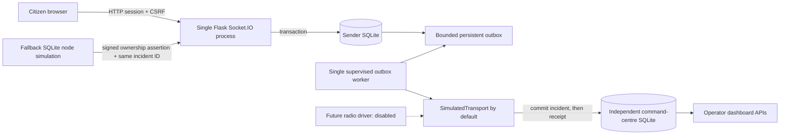
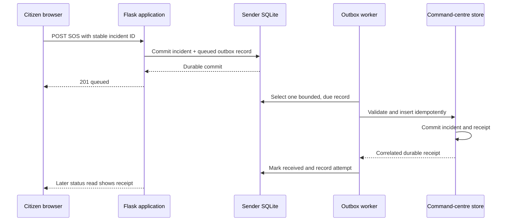

# Current software architecture

The software simulator does not model LoRa delivery, route diversity, RF timing, link authentication, or physical failover. The separately stored command-centre database is durable, but not every dashboard read and lifecycle mutation has yet been moved there; see [the completion matrix](software-completion-matrix.md).

## Supported process topology

Run one web process and exactly one worker per local SQLite deployment. Both entry points use host-local advisory lock files derived from the sender database path. This blocks accidental second instances on one host, but does not coordinate across hosts or filesystems. Do not run multiple WSGI workers or replicas against the same SQLite files. A database server or distributed Socket.IO coordination would be a separate architecture change.
